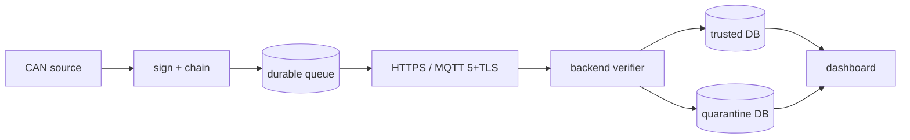

# VIGIL-TRUST

**Verifiable Vehicle Telematics Security Gateway** -- a hackathon prototype
(PS04, IIITB COMET Foundation x Qualcomm) demonstrating a CAN-to-wireless
telematics pipeline that stays verifiable from capture to backend, even
across network outages.

> This is a prototype. Not production-certified. No ISO/SAE 21434, UNECE
> R155, or IEEE 1609.2 compliance is claimed. See docs/LIMITATIONS.md.

## The problem, in one paragraph

Telematics gateways expose CAN-derived vehicle data over wireless links,
where it can be intercepted, altered, replayed, or spoofed. TLS protects
the wire, but once data is written to a broker, a database, or another
internal service, TLS has nothing left to say about it. VIGIL-TRUST signs
each telemetry event at the application layer, chains events together
with hashes, batches them under a Merkle root, and has the backend issue
signed acceptance checkpoints -- so provenance, integrity, freshness, and
continuity all survive past the point where the TLS session ends.

## Why TLS alone is not enough (the short version)

TLS authenticates and encrypts a *connection*. It says nothing about
whether a record pulled out of a database six months later is the same
bytes the gateway actually signed, in the order they were actually
produced. See docs/ARCHITECTURE.md for the full argument.

## Architecture



Full diagram and module map: docs/ARCHITECTURE.md.

## Quick start

```bash
python -m venv .venv
.venv/Scripts/python.exe -m pip install -e ".[dev]"   # .venv/bin/python on Linux/macOS

# One-time demo PKI + device registration
.venv/Scripts/python.exe scripts/generate_backend_key.py
.venv/Scripts/python.exe scripts/dev_pki.py --device gw-demo-01
.venv/Scripts/python.exe scripts/register_device.py --device-id gw-demo-01 \
    --public-key-path certs/devices/gw-demo-01.pub.pem --vehicle-profile demo-v1 \
    --db-path data/backend/registry.db

# Terminal 1: backend + dashboard
.venv/Scripts/python.exe -m backend.main
# open http://127.0.0.1:8443/

# Terminal 2: edge gateway (simulator or replay)
VIGIL_GATEWAY_ID=gw-demo-01 VIGIL_DEVICE_KEY_PATH=certs/devices/gw-demo-01.key \
VIGIL_BACKEND_URL=http://127.0.0.1:8443 \
.venv/Scripts/python.exe -m edge.main --mode replay --replay-log data/synthetic_can.log
```

See `make` targets in `Makefile` for shortcuts, and DEMO_SCRIPT.md for the
full rehearsed walkthrough.

## PCAN mode

```bash
export CAN_INTERFACE=pcan CAN_CHANNEL=PCAN_USBBUS1 CAN_BITRATE=500000
.venv/Scripts/python.exe -m edge.main --mode pcan
```

STATUS: implemented against the `python-can` API, **not hardware-validated
in this environment** (no PEAK adapter available here). See
docs/PCAN_SETUP.md.

## Attack demo commands

```bash
.venv/Scripts/python.exe -m attack_lab.spoof_identity
.venv/Scripts/python.exe -m attack_lab.tamper
.venv/Scripts/python.exe -m attack_lab.replay
.venv/Scripts/python.exe -m attack_lab.duplicate
.venv/Scripts/python.exe -m attack_lab.reorder
.venv/Scripts/python.exe -m attack_lab.batch_root_forgery
.venv/Scripts/python.exe -m attack_lab.checkpoint_mismatch
.venv/Scripts/python.exe -m attack_lab.device_revocation
.venv/Scripts/python.exe -m attack_lab.outage_reconnect
.venv/Scripts/python.exe -m attack_lab.db_tamper_check data/backend/trusted.db
```

Each prints a `[PASS]`/`[FAIL]` line and exits 0/1 accordingly. Full
captured output: TEST_RESULTS.md.

## Tests

```bash
.venv/Scripts/python.exe -m pytest tests -v
```

52 passed, 3 skipped (hardware/broker not available here) -- see
TEST_RESULTS.md for the full run and TEST_PLAN.md for what each level
covers.

## What is implemented

- Canonical CBOR event schema + COSE_Sign1-style ECDSA P-256 signing
  (`edge/trust/`)
- Hash chain + Merkle batch commitments + signed backend acceptance
  checkpoints
- Durable SQLite store-and-forward queue, survives process restart
- HTTPS transport, fully tested end-to-end (real `uvicorn` process +
  real HTTP, not just in-process)
- MQTT 5 + TLS transport, implemented, integration-tested only when a
  broker is reachable
- Backend device registry, verifier, trusted/quarantine stores, REST API
- Web dashboard (status, verified/rejected counters, queue depth via edge
  metrics, incident timeline, reason histogram, device status)
- All 10 required attack-lab scenarios, both as pytest and as standalone
  CLI scripts
- Reproducible benchmark script with real numbers (BENCHMARK_RESULTS.md)

## What is hardware-pending / not implemented

- Arduino UNO Q: the MCU<->Linux Bridge wire protocol itself IS
  implemented and cross-verified between Python and C without needing
  hardware (`edge/acquisition/unoq_protocol.py`,
  `firmware/uno_q_mcu/bridge_protocol/`, see
  `firmware/uno_q_mcu/tests/README.md`). The serial I/O
  (`edge/acquisition/unoq.py`), CAN peripheral access
  (`firmware/uno_q_mcu/can_rx/`), and top-level sketch are written but
  **not hardware-validated** -- no board was available; they fail with a
  clear, explicit error rather than faking data.
- Hardware-backed (STM32U585 TrustZone) signing -- software signer only.
- PCAN/SocketCAN real-hardware validation -- code exists, not run against
  real hardware here.
- `docker-compose.yml` / `Dockerfile.backend` -- written, not built/run
  (no Docker available here).

Full, honest breakdown: docs/LIMITATIONS.md.

## Non-certification disclaimer

VIGIL-TRUST is a hackathon reference design. It does not claim ISO/SAE
21434 or UNECE R155 compliance, IEEE 1609.2/ETSI C-ITS conformance,
hardware security certification, or production readiness of any kind.
Every cryptographic primitive used is a standard, well-known one (ECDSA
P-256/SHA-256, SHA-256 hash chains, Merkle trees, TLS) -- the contribution
claimed here is the integrated reference-design and its demonstrated
continuity properties across TLS termination and offline buffering, not a
new cryptographic invention. See
VIGIL_TRUST_Research_and_Architecture.md section 5 for the full novelty
analysis.

## Repository map

| Doc | Contents |
|---|---|
| docs/ARCHITECTURE.md | Module map, data flow diagram |
| docs/THREAT_MODEL.md | In/out of scope, attack -> reason-code table |
| docs/PROTOCOL.md | Wire formats, canonical schema, COSE/chain/Merkle/checkpoint math |
| docs/SECURITY.md | Controls implemented, input validation, secrets handling |
| docs/PCAN_SETUP.md | PCAN/SocketCAN bring-up procedure |
| docs/UNO_Q_SETUP.md | UNO Q bring-up procedure (not yet executed) |
| docs/LIMITATIONS.md | Everything NOT proven/implemented, stated plainly |
| DEMO_SCRIPT.md | 5-7 minute rehearsed demo |
| TEST_PLAN.md / TEST_RESULTS.md | What is tested, and actual captured results |
| BENCHMARK_RESULTS.md | Real, reproducible performance numbers |
| THIRD_PARTY_NOTICES.md | Dependency license inventory |
| firmware/uno_q_mcu/README.md | MCU protocol spec + firmware skeleton |
