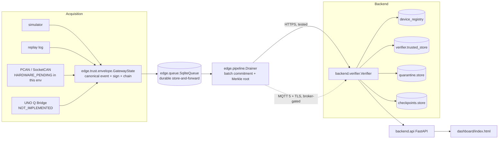

# Architecture

## Data flow

## Module map

| Path | Responsibility |
|---|---|
| `edge/acquisition/` | Passive CAN frame sources behind one interface (`AcquisitionSource`): simulator, replay, PCAN, SocketCAN, UNO Q (stub) |
| `edge/trust/` | Canonical serialization, COSE_Sign1-style signing, hash chain, Merkle tree, checkpoints, per-boot gateway state |
| `edge/queue/` | Durable SQLite store-and-forward queue + last-checkpoint store |
| `edge/transport/` | HTTPS (tested) and MQTT 5+TLS (broker-gated) submission to the backend |
| `edge/pipeline.py` | Drains the queue in batch order, builds/signs batch commitments, calls the transport |
| `edge/api/metrics_server.py` | Localhost-only `/metrics` for the edge process |
| `backend/device_registry/` | gateway_id -> public key + trusted/revoked state |
| `backend/verifier/` | Core verification pipeline + trusted telemetry database |
| `backend/quarantine/` | Rejected-record database with reason codes |
| `backend/checkpoints/` | Backend-issued, signed acceptance checkpoints |
| `backend/api/` | FastAPI app: ingestion, health, metrics, devices, events, quarantine, dashboard static mount |
| `dashboard/` | Static HTML+JS polling the backend REST API |
| `attack_lab/` | Standalone runnable attack scenarios + a DB tamper-check utility |
| `scripts/` | Demo PKI generation, device registration, backend key generation, benchmark |
| `firmware/uno_q_mcu/` | Protocol spec + firmware skeleton (not hardware-validated) |

## Why application-layer signatures in addition to TLS

TLS (optionally mTLS) protects the wire between the gateway and the
backend. It does **not** protect the telemetry object once it has been
written to a broker, a database, or passed to another internal service.
Signing the canonical event bytes themselves (edge/trust/cose_signer.py)
means the signature travels with the data and can be independently
re-verified by anything holding the device's public key, long after the
original TLS session has closed. See
VIGIL_TRUST_Research_and_Architecture.md section 6.5 for the fuller
argument and MQTT 5 spec citation.

## Edge/backend split rationale

The architecture keeps acquisition, trust-envelope construction, durable
queuing, and transport as separate modules specifically so that:

- A different acquisition backend (replay vs. PCAN vs. future UNO Q) never
  touches signing/chaining/queuing code.
- A different transport (HTTPS vs. MQTT) implements the same `Transport`
  interface (edge/transport/base.py) and is swappable without touching the
  pipeline logic.
- The backend's `Verifier` (backend/verifier/verifier.py) is the single
  place untrusted input becomes trusted data; everything upstream of it is
  attacker-controlled by assumption.

## Production target (not this prototype)

See VIGIL_TRUST_Research_and_Architecture.md section 14.2-14.3 for the
production architecture target (automotive-qualified hardware, HSM,
cellular/5G, production PKI, ISO/SAE 21434 work products). This prototype
is Phase 1 of that roadmap only.
